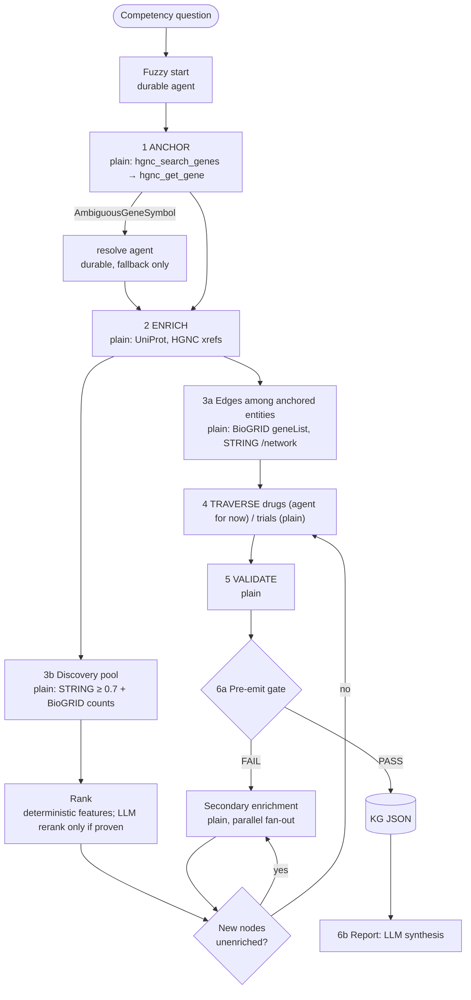

# ADR-TEMPORAL-001: Run each CQ phase on the cheapest mechanism the evidence supports

| | |
|---|---|
| **Status** | Proposed |
| **Date** | 2026-10-21 |
| **Scope** | Project: binds `biosciences-temporal` only |
| **Owner** | Temporal Engineer |
| **Reviewers** | Platform Architect, Program Director |
| **Grounded in** | `docs/SPIKE_TEMPORAL_DURABILITY.md` (added with this ADR), cited as `[SPIKE §<section>]`. The spike's code and scripts are on branch `spike/temporal-durability` (not merged). |
| **Placement** | Project-scoped per `biosciences-program/docs/adr/README.md`; first of the `ADR-TEMPORAL-` series. The program index ("Where things are") needs a row when this is accepted. |
| **Audience** | Temporal Engineer, Platform Architect, Research Workflows Engineer |

> Every number below comes from one spike run on 2026-10-21 against live APIs, local
> biosciences-mcp at `0430e52`, Pydantic AI 2.59.0, temporalio 1.34.0. Most runs were
> executed once. Statements the spike did not measure are marked **ASSUMPTION**.

---

## 1. Context

### 1.1 What the repo does today

CQ14 runs five phases (Anchor, Enrich, Expand, Traverse, Validate). Each phase is one
PydanticAI agent, and each Temporal activity runs one whole agent, MCP lifecycle
included: the **one-shot pattern** (`docs/TEMPORAL_MCP_STATUS.md`, `CLAUDE.md`
Architecture). It was adopted because `TemporalAgent` + MCP hit an anyio cancel-scope
error in Pydantic AI 1.x / MCP SDK 1.25. The workflow runs with
`UnsandboxedWorkflowRunner` because Pydantic AI imports failed in the sandbox.

### 1.2 What changed

- Pydantic AI 2.x ships `TemporalDurability`: each model request and each MCP call is its
  own activity. On 2.59.0 the resolve agent ran this way with **no cancel-scope errors**
  and in the **default sandboxed runner** with `PydanticAIPlugin` [SPIKE §Results].
- Most phase work is a fixed sequence of strict lookups by resolved ID (the "Fact" half of
  Fuzzy-to-Fact). Plain code reproduced the agents' identifiers exactly and did it faster
  and with no model calls [SPIKE §Anchor and Enrich without an LLM; §Gold-standard baseline].
- The canonical phase ladder (`/ob-research`, graph-builder skill) adds an Expand
  secondary-enrichment loop and a pre-emit gate this repo doesn't implement; both ran as
  plain activities [SPIKE §Phase 3 EXPAND loop].

### 1.3 Source synthesis matrix

| Source | Format | Technical scope | Key subsystems and stack |
|---|---|---|---|
| `docs/SPIKE_TEMPORAL_DURABILITY.md` | Markdown, measured results | Durable vs one-shot under crash; plain phases vs agents; Expand loop + gate; gold-standard baseline; reranking ablation; 11 findings | Temporal 1.34, Pydantic AI 2.59 (`TemporalDurability`, `PydanticAIPlugin`), FastMCP `StdioTransport`/HTTP, biosciences-mcp + -edge, Pydantic AI Gateway → Claude Sonnet 5 |
| `docs/TEMPORAL_MCP_STATUS.md` | Markdown | Why the one-shot pattern exists (cancel-scope bug, Jan 2026, Pydantic AI 1.42) | `TemporalAgent`, `MCPServerStdio` |
| Pydantic AI Temporal guide (pydantic.dev, v2.0.0 docs) | Docs | `TemporalDurability`, activity config, `max_retries=0` on the model client, stable names/IDs | [SPIKE §Sources] |
| Temporal docs, Child Workflows | Docs | Start with one workflow + activities; children only for a concrete reason | [SPIKE §Sources] |
| `open-biosciences-plugins` graph-builder skill | Skill spec | Canonical phases 1–6a, secondary enrichment, pre-emit gate | [SPIKE §Phase 3 EXPAND loop] |
| CQ dataset `biosciences-competency-questions-sample` @ `4fd7a86d` | HF dataset | 15 CQs, 21 gene entities, 9 gene-gene gold edges | [SPIKE §Gold-standard baseline] |

## 2. Decision

**Each phase runs on the cheapest mechanism the evidence supports. Strict lookups are
plain activities that call MCP tools directly. Steps that need judgment run as Pydantic
AI durable agents (`TemporalDurability`). The one-shot agent-per-activity pattern is
retired.**

### 2.1 Phase → mechanism

| Phase (canonical) | Mechanism | Why | Evidence |
|---|---|---|---|
| Question → entities (fuzzy start) | Durable agent | Interpretation of free text | not measured; ASSUMPTION: the CQ runner's key entities stand in for this today |
| 1 ANCHOR | **Plain activity**; durable-agent fallback only for `AmbiguousGeneSymbol` | 24/24 gold gene entities across all 15 CQs (agent 14/14 where valid); agent turned an unknown symbol into `hgnc_id="NOT_FOUND"`. Compounds: 6/8, needs synonym search | [SPIKE §Full CQ validation; §Anchor and Enrich] |
| 2 ENRICH (HGNC cross-refs, UniProt function) | **Plain activity** | IDs identical; agent paraphrased source text (similarity 0.09–0.47) and invented keywords the tool doesn't return | [SPIKE §Anchor and Enrich] |
| 3 EXPAND: edges among anchored entities | **Plain activity** (BioGRID `geneList` + `includeInteractors=false`; STRING `/network`) | Every gold gene-gene edge joins two of the CQ's own key entities; one call returns evidence-typed edges with PMIDs | [SPIKE §Both MCP servers; §Reranking experiment] |
| 3 EXPAND: discovery pool + secondary enrichment loop + gate | **Plain activities**, parallel fan-out; **pool source chosen by question type**: STRING/BioGRID physical for interaction and regulation questions, genetic sources (BioGRID genetic, ORCS, DepMap) for synthetic lethality | 52 nodes, gate PASS, 52s, 0 model requests; STRING ≥ 0.7 pool holds 8/9 CQ gold partners but only 4/209 Feng SL partners | [SPIKE §Phase 3 EXPAND loop; §Discovery benchmark] |
| 3 EXPAND: ranking discovery candidates | **Deterministic feature ranking** (BioGRID record count, STRING `escore`); LLM rerank only after it beats that on discovery labels | BioGRID count 6/9 recall@25 vs combined score 4/9; features-only LLM 5/9; named-LLM 7/9 confounded by the question naming a gene | [SPIKE §Reranking experiment] |
| 4a TRAVERSE drugs | **Plain activity for mechanism targets** (biosciences-mcp-edge `get_mechanism`, ChEMBL target → UniProt); durable agent for discovery beyond known drugs | Mechanism data covered 4/6 gold drug → target edges; misses are off-target edges (dasatinib → DDR2, hERG) that need bioactivity data. `opentargets_get_target` returns no known-drugs field, so the skill's Open Targets path isn't available | [SPIKE §Full CQ validation] |
| 4b TRAVERSE trials, 5 VALIDATE, 6a PERSIST + gate | **Plain activities** | drug → trial 2/2 when the query pairs gene and drug; gate measured; VALIDATE not built | [SPIKE §Full CQ validation; §Phase 3] |
| 6b Report / review | LLM synthesis over the frozen KG JSON; outside durability concerns | No API calls after the evidence boundary | `ob-research-graph-build.md` (program diagram) |

### 2.2 Activity contract (applies to every activity)

1. **Filter inside the activity; return slim.** Raw tool payloads can exceed Temporal's
   2 MB default payload limit (STRING TP53 at `limit=10000`: 2.95 MB)
   [SPIKE §Findings 11].
2. **Heartbeat timeout on every activity** (30 s), not only model requests. Without it, a
   crash during an MCP call recovered in 148 s instead of 54 s [SPIKE §Crash and resume].
3. **Model client `max_retries=0`**; Temporal owns retries (Pydantic AI Temporal guide).
4. **Stable names**: agent `name` and toolset `id` never change once deployed.
5. **Fail loudly, non-retryably, on resolution failures**: `GeneNotFound` and
   `AmbiguousGeneSymbol` become non-retryable `ApplicationError`s; ambiguity routes to the
   agent fallback (Linear AGE-743).
6. **Sandboxed runner with `PydanticAIPlugin`**; `UnsandboxedWorkflowRunner` is removed.

### 2.3 Platform pins (until upstream fixes land)

- `pydantic-ai[temporal]>=2.59` with `anthropic<2` (pydantic-ai #10923).
- MCP via `MCPToolset` + FastMCP transports (`MCPServerStdio` no longer exists in 2.x).
- `BIOSCIENCES_MCP_TRANSPORT` selects local stdio (default) or the hosted endpoints the
  bio-research plugin uses, for both biosciences-mcp and biosciences-mcp-edge.
- `.env` loads with `override=True` in every entry point.

## 3. Alternatives considered

1. **Keep the one-shot pattern for all phases (status quo).** Rejected. A crash repeats the
   whole in-flight agent run (2 model requests + 1 MCP call repeated vs 1 model request
   for durable), and recovery took 193–195 s vs 43–53 s [SPIKE §Crash and resume]. Most of
   the recovery gap is timeout configuration, not the pattern (no heartbeat; 3-min
   `start_to_close`), so one-shot + heartbeats would close the time gap but not the
   repeated work. Preferred only if the 2.x upgrade is blocked.
2. **Durable agents for every phase (`TemporalDurability` everywhere).** Rejected for
   strict lookups: 5 model requests per gene where plain code needs 0, 18.6–26.3 s vs 6.9–9.8 s
   per gene, paraphrased source text, and a schema-valid sentinel on failure
   [SPIKE §Anchor and Enrich]. Kept for judgment steps.
3. **Claude Agent SDK + Temporal plugin (temporalio/ai-integrations PR #33), reusing the
   bio-research plugin directly.** Deferred: draft, unmerged; maintainers' open items
   include 0.7–0.9 s restart latency, ~1.4 s per tool activity, and Bash/MCP effects
   repeating on retry. Revisit when merged; the phase split in §2.1 applies there too.
4. **Deep Agents + `temporalio-deepagents`.** Deferred: experimental; requires porting
   `biosciences-deepagents` (MCP endpoint, skills refresh). Not measured in the spike.

### 3.1 ATOM

| Quality attribute | **Hybrid (decided)** | One-shot everywhere | Durable everywhere | Agent SDK plugin (not measured) | Evidence |
|---|---|---|---|---|---|
| Correctness vs source | IDs from records; failures explicit | Agent output; `NOT_FOUND` sentinel seen | Same as one-shot | Agent output | [SPIKE §Anchor and Enrich] |
| Work repeated after crash | ≤ 1 step | Whole in-flight agent run | ≤ 1 model request | Tool effects can repeat (PR #33) | [SPIKE §Crash and resume] |
| Recovery time (3 genes) | 43–54 s with heartbeats | 193–195 s | 43–53 s | — | [SPIKE §Crash and resume] |
| Model requests, Anchor+Enrich | 0 per gene | 5 per gene | ASSUMPTION: ~5 (same agents) | — | [SPIKE §Anchor and Enrich] |
| Latency, Anchor+Enrich | 6.9–9.8 s per gene | 18.6–26.3 s | not measured | — | [SPIKE §Anchor and Enrich] |
| Activities / history size | Many small activities (Expand: 54 for 2 seeds) | Few, large | Many (18 for 3 genes) | Many | [SPIKE §Phase 3; §Crash and resume] |
| Operational complexity | Two code paths (plain + agent) | One path | One path | New dependency, draft | — |
| Upgrade risk | 2.x + `anthropic<2` pin | Stays on 1.x | 2.x + pin | Unmerged plugin | [SPIKE §Findings 1-2] |
| Edge provenance | Evidence type + PMID per edge, from one query | Edges transcribed by the agent from tool output | Same as one-shot | Agent-built | [SPIKE §Both MCP servers] |

**Verdict.** The hybrid wins every measured row except operational simplicity. The cost is
maintaining two code paths, which is bounded: the agent path is reserved for the few
steps that need judgment.

## 4. System decomposition

Rendered and validated: [open/edit](https://l.mermaid.ai/M6Q6XV).



| Layer | Components | Responsibility | Source |
|---|---|---|---|
| Ingestion | biosciences-mcp, biosciences-mcp-edge (stdio or hosted) | Source records | [SPIKE §Both MCP servers] |
| Processing | `deterministic/` (anchor, enrich, expand, graph) | Strict lookups, filtering, gate | [SPIKE §Anchor and Enrich; §Phase 3] |
| Judgment | Pydantic AI agents with `TemporalDurability` | Fuzzy start, ambiguity, drugs (for now), synthesis | [SPIKE §Results] |
| Orchestration | Temporal workflow, sandboxed, `PydanticAIPlugin` | Sequencing, fan-out, retries, heartbeats, replay | [SPIKE §Crash and resume] |
| Evaluation | CQ gold baseline + rerank harness | Feature selection, regression | [SPIKE §Gold-standard baseline; §Reranking] |

## 5. Integration strategies

| Concern | Pattern | Contract | Failure mode to design for | Evidence |
|---|---|---|---|---|
| MCP transport | `MCPToolset`/FastMCP client per activity; stdio default, hosted optional | Tool names and `STRING:`/`HGNC:` CURIEs | Subprocess start ~2–3 s per activity; keep-alive halved wall time (49 → 26 s) | [SPIKE §Results; §Findings 3] |
| Payloads | Filter in activity, return slim models | Pydantic models (`GeneInfo` incl. `location`, `GeneNode`, `Edge`) | > 2 MB results; slim modes that drop filter keys (AGE-744) | [SPIKE §Findings 11] |
| Tool defects | Defensive client code until fixed | — | STRING drops the seed's edges (AGE-741); BioGRID and Open Targets fail a whole gene on one bad upstream record (AGE-745, AGE-747) | [SPIKE §Findings 9; §Gold-standard baseline; §Full CQ validation] |
| Model access | Pydantic AI Gateway → Anthropic, `max_retries=0` | `PYDANTIC_AI_GATEWAY_API_KEY` | anthropic 2.x break (#10923) | [SPIKE §Findings 1] |
| Evaluation | CQ runner gold set + discovery labels | Gold `key_entities`, `biolink_edges` | Gold set tests connecting named entities, not discovery | [SPIKE §Reranking experiment] |

## 6. When not to use

- **A durable agent for a strict lookup.** It costs ≥ 5 model requests per gene and can
  return a schema-valid sentinel; use plain code whenever the inputs are resolved IDs.
- **One-shot for multi-step agents.** Repeated work grows with how far the agent got
  before the crash; if an agent is kept, run it with `TemporalDurability`.
- **Raw tool payloads across a boundary.** Temporal's default payload limit is 2 MB (about
  1.5 MB for base64-encoded binary data, per the Pydantic AI Temporal guide); filter in the
  activity well below that.
- **Combined-score ranking for hub genes.** TP53 has 872 partners at ≥ 0.7 and 83 tied at
  0.999; rank by experimental evidence and budget per seed.
- **Temporal at all, for interactive exploration.** ASSUMPTION: a single interactive CQ
  that finishes in minutes, with no fan-out or approval step, is better served by the
  bio-research plugin in Claude Code/Cowork. Evidence that would settle it: uncrashed
  wall time of a full CQ on each path (not measured).
- **Stdio per activity at scale.** ASSUMPTION: past roughly 100 MCP activities per run,
  prefer keep-alive or the hosted transport; resolve by timing a full Expand on each.

## 7. Pattern

```python
@workflow.defn
class CQWorkflow:
    @workflow.run
    async def run(self, cq: CQInput) -> dict:
        genes = await asyncio.gather(*(self.anchor(s) for s in cq.gene_symbols))
        nodes = await asyncio.gather(*(
            workflow.execute_activity(enrich_gene_node_plain, g.symbol, **PLAIN) for g in genes))
        edges = await workflow.execute_activity(edges_among_plain, [g.symbol for g in genes], **PLAIN)
        pool = await workflow.execute_activity(discovery_pool_plain, cq.seeds, **PLAIN)  # slim, ranked
        nodes += await asyncio.gather(*(
            workflow.execute_activity(enrich_gene_node_plain, p, **PLAIN) for p in pool[: cq.budget]))
        drugs = await drug_agent.run(...)            # TemporalDurability until a plain path is verified
        graph = build_graph(nodes, edges, drugs)
        return gate_or_fail(graph)                    # pre-emit gate, deterministic

    async def anchor(self, symbol: str) -> dict:
        try:
            return await workflow.execute_activity(resolve_gene_plain, symbol, **PLAIN)
        except ActivityError as e:
            if getattr(e.cause, "type", None) != "AmbiguousGeneSymbol":
                raise
            return (await resolve_agent.run(f"Resolve gene: {symbol}")).output  # durable fallback

PLAIN = {"start_to_close_timeout": timedelta(seconds=90), "heartbeat_timeout": timedelta(seconds=30),
         "retry_policy": RetryPolicy(maximum_attempts=3)}
```

## 8. Consequences

**Positive.** Zero model calls for Anchor, Enrich and most of Expand; identifiers and
source text taken directly from records; explicit failures; crash recovery repeats at most
one step; edges carry evidence type and PMID.

**Negative.** Two code paths; more activities and history events per run; a Pydantic AI
major-version upgrade with a temporary `anthropic<2` pin; the `CLAUDE.md` Known Issues
(cancel scope, sandbox, `MCPServerStdio`) must be rewritten.

**Risks and mitigations.**

| Risk | Mitigation | Tracking |
|---|---|---|
| Upstream tool defects distort plain phases | Defensive client code, then fixes upstream | AGE-741, AGE-742, AGE-744, AGE-745 |
| Skill and tool docs disagree with live tools | Fix docs; contract tests | open-biosciences-plugins #31 |
| Hub-gene node selection is a judgment call | Pool rule + deterministic ranking now; decision pending | open-biosciences-plugins #32 |
| Gold set can't evaluate discovery | Discovery labels (e.g. Feng et al. SL pairs, `dwb2023/sl_gene_pairs`) | to file |
| Gold text drift | Correct cq14 wording | biosciences-research #9 |

## 9. Migration (proposed PR order)

1. Gateway routing: open-biosciences/biosciences-temporal#4.
2. `GeneInfo.location` and the `NOT_FOUND` guard (AGE-743): #5.
3. `deterministic/` Anchor + Enrich as plain activities, gated on the gold baseline (21/21).
4. Pydantic AI 2.x + `TemporalDurability` for the remaining agents, sandboxed runner, activity contract §2.2; after #10923 or with the pin.
5. Expand loop, edges-among-entities and the gate, after AGE-741/742/745 are fixed or worked around.
6. `CLAUDE.md` and `docs/TEMPORAL_MCP_STATUS.md` rewritten to match.

## 10. Open questions

- Does an LLM reranker beat deterministic features on discovery labels the question doesn't name? The first benchmark (Feng SL pairs, AGE-746) couldn't answer it: the STRING pool held 4/209 labels, and 205/209 labels exist in BioGRID only as the Feng screen itself. It needs a genetic-source pool and labels independent of the tool data (temporal holdout or leave-one-screen-out).
- ~~Does Open Targets `knownDrugs` make Traverse-drugs deterministic?~~ No: the tool returns no known-drugs field; mechanism data from biosciences-mcp-edge covers the mechanism edges (§2.1).
- Gene ↔ disease and pathway steps: blocked by tool and gold-data defects (AGE-747; biosciences-research#10), not by the plain-vs-agent choice.
- Uncrashed wall time and history size, durable vs one-shot vs hybrid, for a full CQ.
- Hosted vs local MCP transport latency beyond one cold-start sample (10.2 s / 5.4 s).
