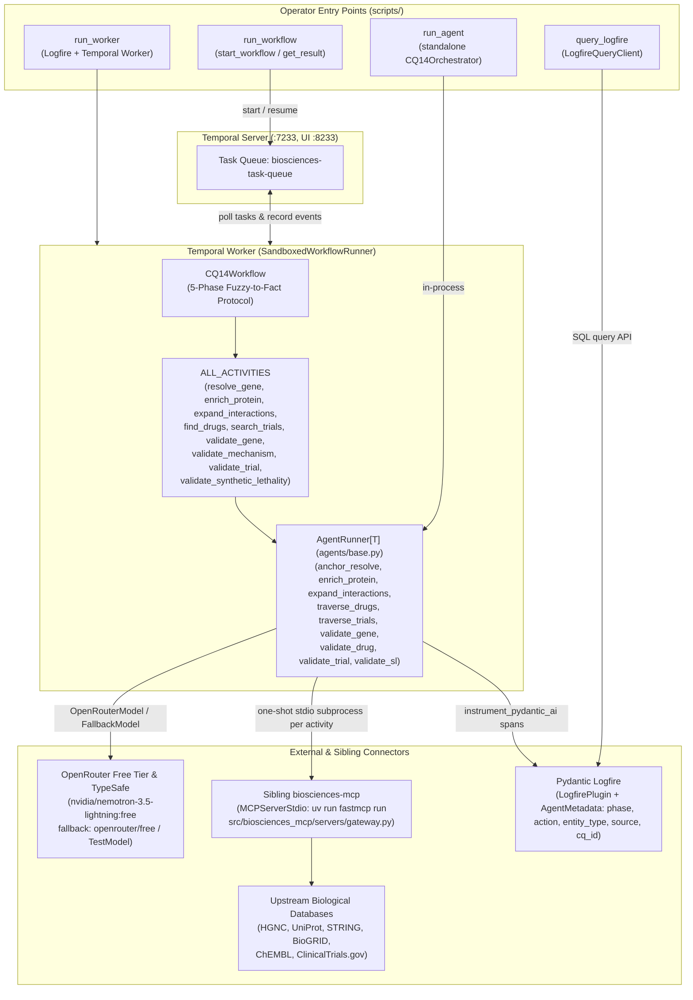
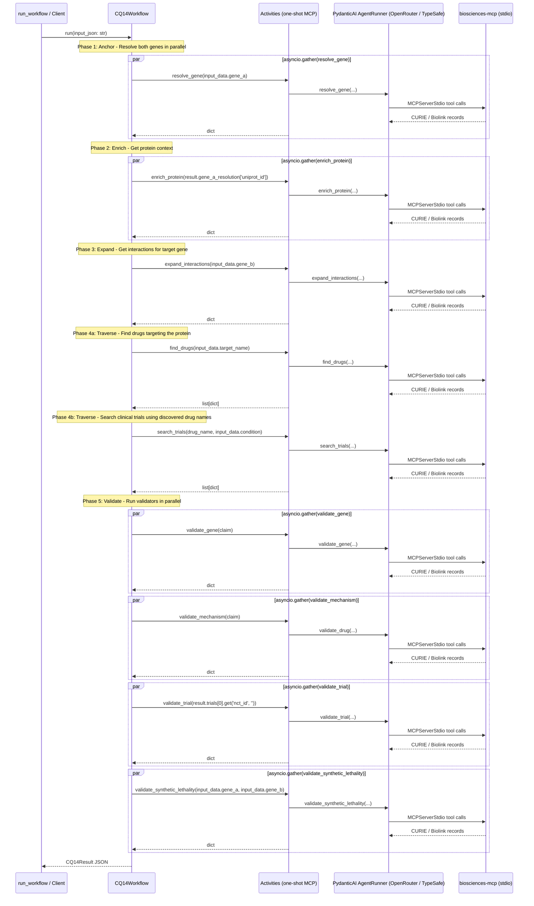

# Phase 2: Architecture Diagrams

The system topology of [`biosciences-temporal`](../../README.md), and the flow and sequence diagram of `CQ14Workflow`.

- **§1 is written by hand.** Its names are checked by `bt_diagram.py drift`'s coverage check.
- **§2 is generated.** [`scripts/bt_diagram.py`](../../scripts/bt_diagram.py) reverse-engineers it from the source with `ast`; `write` refills it and `drift` fails when it is stale. Don't edit between the markers.

---

## 1. System topology and process boundaries

---

## 2. Workflow diagrams (generated)

<!-- BEGIN GENERATED: scripts/bt_diagram.py write; do not edit by hand -->
### `CQ14Workflow`

```mermaid
flowchart TD
    start(["CQ14Workflow.run(input_json: str)"])
    s0["Phase 1: Anchor<br/><b>resolve_gene</b><br/>timeout timedelta(minutes=3)<br/><i>asyncio.gather · agent:resolve_gene · model:create_model() · fault-tolerant</i>"]:::fanout
    start --> s0
    s1["Phase 2: Enrich<br/><b>enrich_protein</b><br/>timeout timedelta(minutes=3)<br/><i>asyncio.gather · agent:enrich_protein · model:create_model() · fault-tolerant</i>"]:::fanout
    s0 --> s1
    s2["Phase 3: Expand<br/><b>expand_interactions</b><br/>timeout timedelta(minutes=5)<br/><i>agent:expand_interactions · model:create_model() · fault-tolerant</i>"]:::activity
    s1 --> s2
    s3["Phase 4a: Traverse<br/><b>find_drugs</b><br/>timeout timedelta(minutes=5)<br/><i>agent:find_drugs · model:create_model() · fault-tolerant</i>"]:::activity
    s2 --> s3
    s4["Phase 4b: Traverse<br/><b>search_trials</b><br/>timeout timedelta(minutes=5)<br/><i>agent:search_trials · model:create_model() · fault-tolerant</i>"]:::activity
    s3 --> s4
    s5["Phase 5: Validate<br/><b>validate_gene</b><br/>timeout timedelta(minutes=3)<br/><i>asyncio.gather · agent:validate_gene · model:create_model() · fault-tolerant</i>"]:::fanout
    s4 --> s5
    s6["Phase 5: Validate<br/><b>validate_mechanism</b><br/>timeout timedelta(minutes=3)<br/><i>asyncio.gather · agent:validate_drug · model:create_model() · fault-tolerant</i>"]:::fanout
    s5 --> s6
    s7["Phase 5: Validate<br/><b>validate_trial</b><br/>timeout timedelta(minutes=3)<br/><i>asyncio.gather · agent:validate_trial · model:create_model() · fault-tolerant</i>"]:::fanout
    s6 --> s7
    s8["Phase 5: Validate<br/><b>validate_synthetic_lethality</b><br/>timeout timedelta(minutes=3)<br/><i>asyncio.gather · agent:validate_synthetic_lethality · model:create_model() · fault-tolerant</i>"]:::fanout
    s7 --> s8
    done(["return CQ14Result JSON"])
    s8 -->|complete| done
    classDef activity fill:#e8f0fe,stroke:#3b6fd8
    classDef fanout fill:#e6f4ea,stroke:#137333,stroke-width:2px
```

<!-- END GENERATED -->
