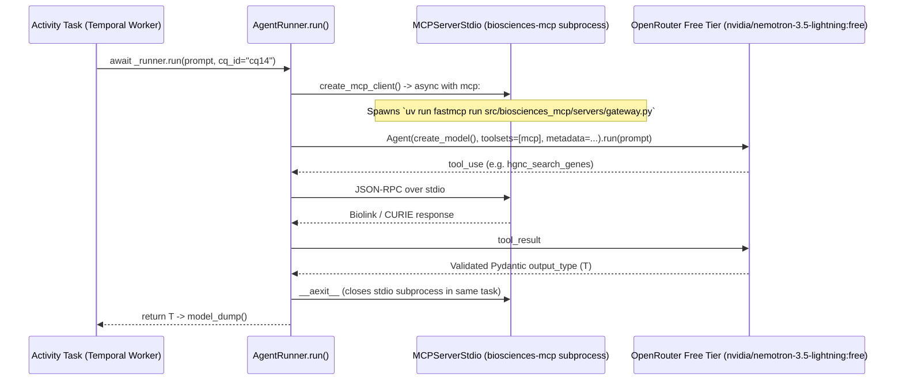

# Phase 3: Data Flows

How [`CQ14Workflow`](../../src/biosciences_temporal/temporal/workflows.py) moves data across the 5-phase Fuzzy-to-Fact protocol, manages the one-shot `MCPServerStdio` subprocess lifecycle, and routes LLM calls through OpenRouter free-tier models with Logfire OpenTelemetry tracing.

---

## 1. The 5-Phase Fuzzy-to-Fact execution lifecycle

`CQ14Workflow.run` accepts `input_json: str` (`CQ14Input`: `gene_a="TP53"`, `gene_b="TYMS"`, `target_name="thymidylate synthase"`, `condition="cancer"`) and builds `CQ14Result`:

| Phase | Step & Concurrency | Activity (`temporal/activities.py`) | AgentRunner (`agents/`) | Data Transformation |
| :--- | :--- | :--- | :--- | :--- |
| **Phase 1: Anchor** | Parallel `asyncio.gather(..., return_exceptions=True)` | `resolve_gene` (x2 for `gene_a` and `gene_b`) | `anchor_resolve` ([`resolve.py`](../../src/biosciences_temporal/agents/resolve.py)) | Resolves fuzzy gene symbols via `hgnc_search_genes` → `hgnc_get_gene` into `GeneInfo` (`hgnc_id`, `uniprot_id`, `entrez_id`, `ensembl_id`). |
| **Phase 2: Enrich** | Parallel `asyncio.gather(..., return_exceptions=True)` | `enrich_protein` (for resolved `uniprot_id`s) | `enrich_protein` ([`enrich.py`](../../src/biosciences_temporal/agents/enrich.py)) | Prepends `UniProtKB:` CURIE prefix if absent and calls `uniprot_get_protein` to populate `ProteinFunction` (`function_summary`, `keywords`). |
| **Phase 3: Expand** | Sequential (`try / except Exception`) | `expand_interactions` (`gene_b`) | `expand_interactions` ([`expand.py`](../../src/biosciences_temporal/agents/expand.py)) | Queries `string_search_proteins`, `string_get_interactions`, and `biogrid_get_interactions` for `list[GeneInteraction]` (`Negative Genetic` synthetic lethality edges). |
| **Phase 4a: Traverse (Drugs)** | Sequential (`try / except Exception`) | `find_drugs` (`target_name`) | `traverse_drugs` ([`drugs.py`](../../src/biosciences_temporal/agents/drugs.py)) | Queries `chembl_search_compounds` and `chembl_get_compound` for approved Phase 4 `list[DrugCandidate]`. |
| **Phase 4b: Traverse (Trials)** | Sequential (`try / except Exception`) | `search_trials` (`drug_name`, `condition`) | `traverse_trials` ([`trials.py`](../../src/biosciences_temporal/agents/trials.py)) | Uses `result.drugs[0]["name"]` (falling back to `target_name`) to query `clinicaltrials_search_trials` for `list[ClinicalTrial]` (`NCT:NNNNNNNN` CURIEs). |
| **Phase 5: Validate** | Parallel `asyncio.gather(..., return_exceptions=True)` | `validate_gene` (x2), `validate_mechanism` (top 2 drugs), `validate_trial` (first trial), `validate_synthetic_lethality` (`gene_a`, `gene_b`) | `validate_gene`, `validate_drug`, `validate_trial`, `validate_sl` ([`validate.py`](../../src/biosciences_temporal/agents/validate.py)) | Cross-checks claims against HGNC, ChEMBL, ClinicalTrials.gov, and BioGRID (`max_results=100`), returning `list[ValidationEvidence]`. |

---

## 2. One-shot `MCPServerStdio` lifecycle ([`base.py`](../../src/biosciences_temporal/agents/base.py))

To avoid `RuntimeError: Attempted to exit cancel scope in a different task` when Temporal runs activities across async tasks, `AgentRunner.run` scopes the MCP client strictly to a single activity invocation:

---

## 3. Structured Logfire metadata attribution

Every `AgentRunner` attaches `AgentMetadata.to_dict(cq_id)` (`phase`, `action`, `entity_type`, `source`, `cq_id`) to `pydantic_ai.Agent(..., metadata=...)`. Valid values are defined in [`docs/metadata-spec.md`](../metadata-spec.md) and verified statically by `scripts/bt_diagram.py . check`.
