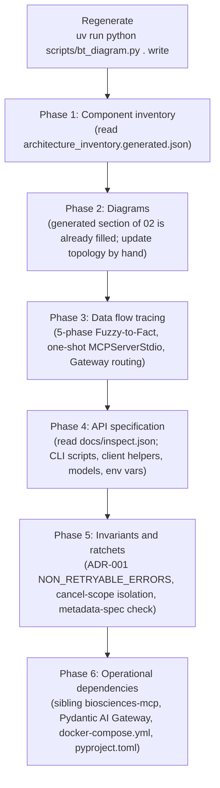

# Agent Instructions: Generating & Updating Reverse Architecture (RA) Documentation

This protocol tells AI agents (Claude Code, Codex, Antigravity) how to update the architecture documentation in `docs/ra_architecture/` for `biosciences-temporal`. Scripts extract the facts; agents write prose from them and don't re-derive them by hand.

---

## 1. Grounding Invariants for `biosciences-temporal`

1. **Symbol-Level Citations:** Every workflow, activity, `AgentRunner`, and model links to its source file under `src/biosciences_temporal/` and names the symbol (e.g. [`workflows.py`](../../src/biosciences_temporal/temporal/workflows.py) `CQ14Workflow`). Relative links carry no line-number fragments (`#L...`); line numbers belong only in SHA-pinned GitHub permalinks. Absolute `file:///` URLs and legacy `src/cq14_temporal/` paths are prohibited.
2. **One-Shot Activity-Scoped MCP Lifecycle:** Never document or introduce shared `MCPServerStdio` instances across activities or inside workflow code. Each `AgentRunner.run` call creates, enters, and closes its own `MCPServerStdio` within a single activity task to prevent `anyio` cancel-scope errors.
3. **Generated, not copied:** Workflow diagrams live only in the generated section of `02_architecture_diagrams.md`, which `scripts/bt_diagram.py write` fills. Names and contracts come from `architecture_inventory.generated.json` and `docs/inspect.json`.
4. **No Dangling Citations:** All referenced paths, models, and CLI scripts must resolve on disk.

---

## 2. When to Update Reverse Architecture Docs

Update this suite when any of these change:
- a Temporal workflow (`@workflow.defn`) or activity (`@activity.defn`) in `temporal/workflows.py`, `temporal/activities.py`, or `temporal/worker.py`;
- an `AgentRunner` or `AgentMetadata` definition in `agents/`;
- the Pydantic models in `agents/models.py`;
- the metadata taxonomy in `docs/metadata-spec.md`;
- timeouts (`config/timeouts.py`), retry policies (`config/retry_policies.py`), or CLI scripts (`scripts/`).

`bt_diagram.py check` fails when activity registrations, timeouts, or `AgentMetadata` taxonomy values disagree with `docs/metadata-spec.md`. `bt_diagram.py drift` fails when a generated file is stale, or when a workflow, activity, agent, or CLI script isn't mentioned in these docs. `document_architecture.py --check` fails when `docs/inspect.json` is stale.

---

## 3. The 6-Phase Execution Protocol



---

## 4. Verification Gate

Run before committing:

```bash
uv run python scripts/bt_diagram.py . write           # regenerate everything
uv run python scripts/bt_diagram.py . check           # rule & metadata-spec checks
uv run python scripts/bt_diagram.py . drift           # stale files and RA coverage gaps
uv run python scripts/document_architecture.py --check
uv run ruff check .
```
